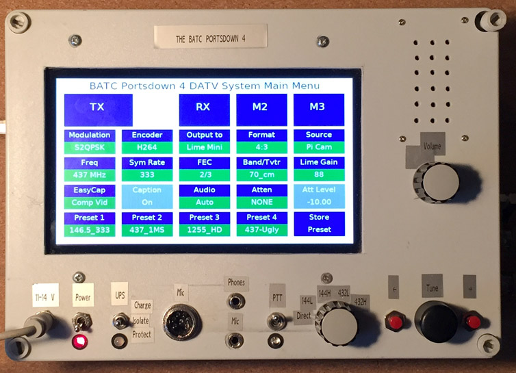

# Portsdown Buster Build For RPi 4

Experimental Pi 4/Trixie `armhf` and `arm64` native Portsdown transmitter
work, plus a standalone DATV-Express DVB-S2 backend, is summarized in the
[development status note](doc/trixie-development-status.md). It is not an
installable or RF-verified release; the instructions below remain for Buster.

**The Portsdown 4** is a DVB-S and DVB-S2 digital television system for the Raspberry Pi 4.  The core of the system was written by Evariste Courjaud F5OEO and is maintained by him.  This BATC Version, known as the Portsdown, has been developed by a team of BATC members for use with a LimeSDR, Pluto or a DATV Express PCB and a MiniTiouner or Knucker tuner.  The intention is that the design should be reproducible by someone who has never used Linux before.  Detailed instructions on loading the software are listed below, and further details of the complete system design and build are on the BATC Wiki at https://wiki.batc.org.uk/The_Portsdown_Transmitter.  There is a Forum for discussion of the project here: https://forum.batc.org.uk/viewforum.php?f=103

This version is based on Raspberry Pi OS Buster Lite and is only compatible with the Raspberry Pi 4 and 7 inch screen (or DFRobot 5 inch DSI Screen).  

Our thanks to Evariste, Heather, Charles and all the other contributors to this community project.  All code within the project is GPL.

# Installation for BATC Portsdown RPi 4 Version

The preferred installation method only needs a Windows PC connected to the same (internet-connected) network as your Raspberry Pi.  Do not connect a keyboard or HDMI display directly to your Raspberry Pi.

- First download the 2023-05-03 release of Raspberry Pi OS Lite (Legacy) on to your Windows PC from here 
https://downloads.raspberrypi.org/raspios_oldstable_lite_armhf/images/raspios_oldstable_lite_armhf-2023-05-03/2023-05-03-raspios-buster-armhf-lite.img.xz

- Unzip the image (using 7zip as it is a .xz compressed file) and then transfer it to a Micro-SD Card using Win32diskimager https://sourceforge.net/projects/win32diskimager/

- Before you remove the card from your Windows PC, look at the card with windows explorer; the volume should be labeled "boot".  Create a new empty file called ssh in the top-level (root) directory by right-clicking, selecting New, Text Document, and then change the name to ssh (not ssh.txt).  You should get a window warning about changing the filename extension.  Click OK.  If you do not get this warning, you have created a file called ssh.txt and you need to rename it ssh.  IMPORTANT NOTE: by default, Windows (all versions) hides the .txt extension on the ssh file.  To change this, in Windows Explorer, select File, Options, click the View tab, and then untick "Hide extensions for known file types". Then click OK.

- If you have a Pi Camera and/or touchscreen display, you can connect them now.  Power up the RPi with the new card inserted, and a network connection.  Do not connect a keyboard or HDMI display to the Raspberry Pi. 

- Find the IP address of your Raspberry Pi using an IP Scanner (such as Advanced IP Scanner http://filehippo.com/download_advanced_ip_scanner/ for Windows, or Fing on an iPhone) to get the RPi's IP address 

- From your windows PC use Putty (http://www.chiark.greenend.org.uk/~sgtatham/putty/download.html) to log in to the IP address that you noted earlier.  You will get a Security warning the first time you try; this is normal.

- Log in (user: pi, password: raspberry) then cut and paste the following code in, one line at a time:


```sh
wget https://raw.githubusercontent.com/BritishAmateurTelevisionClub/portsdown4/master/install_portsdown.sh
chmod +x install_portsdown.sh
./install_portsdown.sh
```

The initial build can take between 45 minutes and one hour, however it does not need any user input, so go and make a cup of coffee and keep an eye on the touchscreen.  When the build is finished the Pi will reboot and start-up with the touchscreen menu.

- If your ISP is Virgin Media and you receive an error after entering the wget line: 'GnuTLS: A TLS fatal alert has been received.', it may be that your ISP is blocking access to GitHub.  If (only if) you get this error with Virgin Media, paste the following command in, and press return.
```sh
sudo sed -i 's/^#name_servers.*/name_servers=8.8.8.8/' /etc/resolvconf.conf
```
Then reboot, and try again.  The command asks your RPi to use Google's DNS, not your ISP's DNS.

- If your ISP is BT, you will need to make sure that "BT Web Protect" is disabled so that you are able to download the software.

- When it has finished, the installation will reboot and the touchscreen should be activated.  You will need to log in to the console to set up any other displays or advanced options.


# Advanced notes

To load the development version, cut and paste in the following lines:

```sh
wget https://raw.githubusercontent.com/davecrump/portsdown4/master/install_portsdown.sh
chmod +x install_portsdown.sh
./install_portsdown.sh -d
```

To load a version from your own GitHub repo (github.com/your_account/portsdown4), cut, paste and amend the following lines:
```sh
wget https://raw.githubusercontent.com/your_account/portsdown4/master/install_portsdown.sh
chmod +x install_portsdown.sh
./install_portsdown.sh -u your_account
```
The alternative github user account will need to include forks of the portsdown and avc2ts and longmynd repositories.
